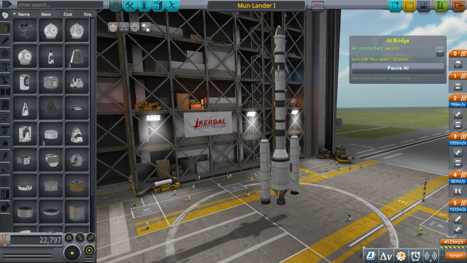
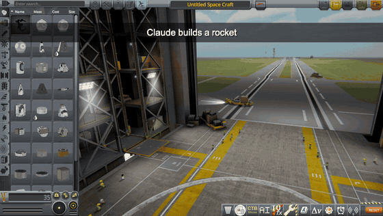
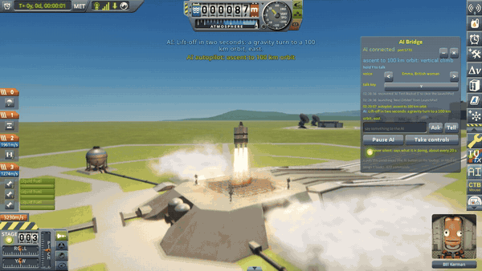
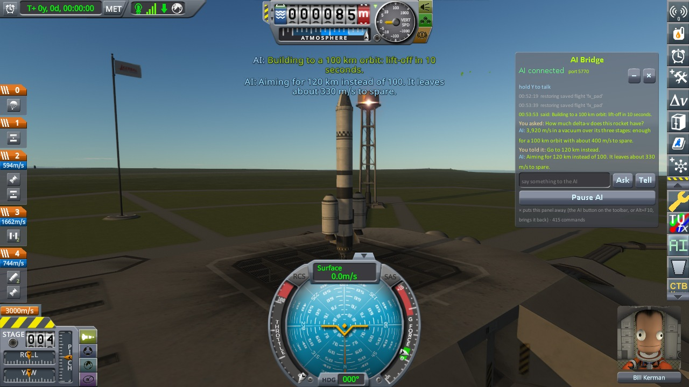

# KSP AI Bridge

A Kerbal Space Program 1 mod that lets an AI design rockets, launch them, fly them and land them for you. You talk
to Claude; Claude plays the game, while you watch, ask it things, and take over whenever you like.

It is self-contained: no kOS, kRPC or MechJeb, and no API key (the AI is the Claude app, or a model you run on your
own computer). A second download, the **voice edition**, adds a ship's computer that speaks and takes spoken orders.







## Install

Needs KSP 1.12.x and Python 3.8 or later. From the download:

```bash
python3 install.py
```

Then start KSP, open a new Claude session in this folder, approve the `ksp` server and ask for something.
[Installing in full](https://github.com/IshiakiZ/ksp-ai-bridge/wiki/Installing).

## Things to ask

* "Build me a rocket that can reach orbit, and fly it there."
* "Design a crewed Mun lander that can get home again, then fly the whole mission."
* "Land next to my Mun base." / "Dock with the station." / "Send Valentina out to plant a flag."

## You stay in charge

* **Talk to it in the game:** the AI Bridge panel has a box to **Ask** a question or **Tell** it to do something else.
* **Never silent:** it answers at once and says a line about every 20 seconds while it works. A switch turns that off.
* **Pause AI** refuses every further command until you press Resume. **Take controls** hands the ship back.
* The server listens only on `127.0.0.1`, with a token that changes at every game start.



## Good to know

* Flown with no human input: a Mun landing and return, landings within tens of metres of chosen coordinates on the
  Mun and Duna, a rendezvous and docking, aircraft (a spaceplane brought home from 11 km up), rovers and an EVA. [The whole list](https://github.com/IshiakiZ/ksp-ai-bridge/wiki/What-has-been-flown) and
  [the limits](https://github.com/IshiakiZ/ksp-ai-bridge/wiki/Limits).

## Works on

Mac: made and flown here. Windows 11: the plugin, the server, flights to orbit and back, and the voice edition's
models were tried; what 0.7.0 to 0.9.0 added (never silent; the clock set without a warp; docking from a rendezvous it
plans, a spaceplane brought down from high up, landings planned on the site's own air) on the Mac only so far.
Linux: never run.

**More:** [the long description](https://github.com/IshiakiZ/ksp-ai-bridge/wiki/The-long-description) (everything in full) and the rest of the
[wiki](https://github.com/IshiakiZ/ksp-ai-bridge/wiki): the tools and autopilots, the voice edition, a model on your own computer.

## Licence

[CC BY 4.0](LICENSE): use it, change it and pass it on as you like, as long as you credit Ishiaki and link back here.

## Developing

`./build.sh check` compiles, `./build.sh dev` makes a hot-reload build that a running KSP swaps in within a
second, `./build.sh release` installs the normal one and `./package.sh` makes the two downloads.
[More](https://github.com/IshiakiZ/ksp-ai-bridge/wiki/Developing).
