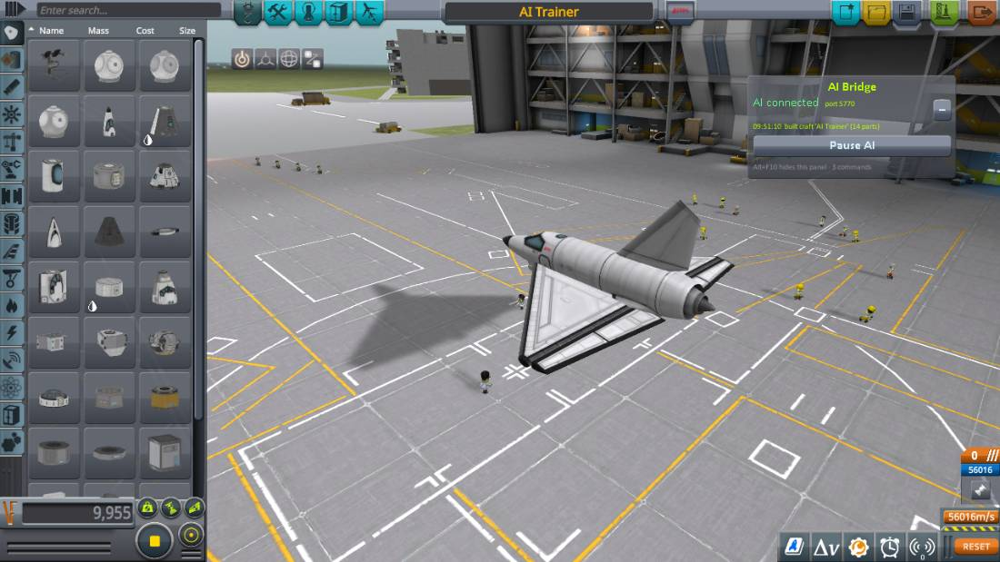
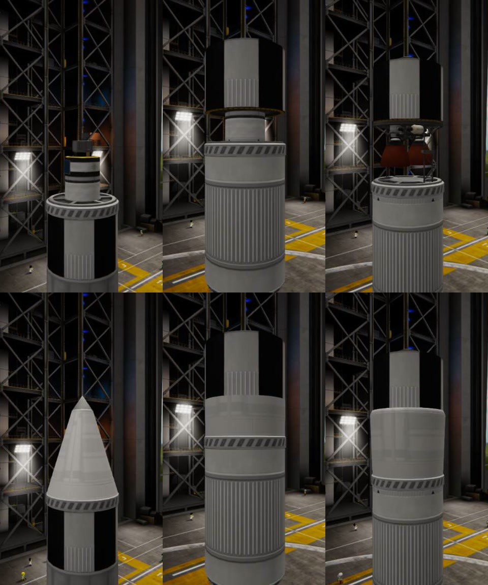
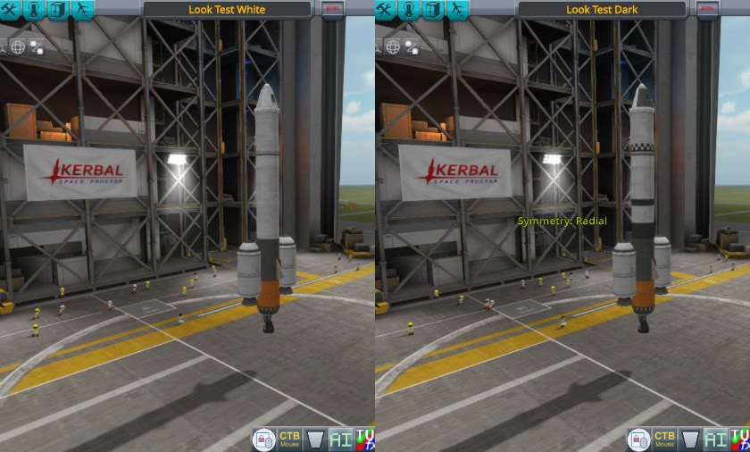

# Describing a craft

`ksp_build` takes a parts list. The first part is the root; every other part says what it attaches to.

```json
{
  "name": "Orbiter",
  "parts": [
    {"id": "pod",   "part": "mk1pod.v2"},
    {"id": "chute", "part": "parachuteSingle", "on": "pod", "node": "top"},
    {"id": "hs",    "part": "HeatShield1", "on": "pod"},
    {"id": "dec",   "part": "Decoupler.1", "on": "hs"},
    {"id": "tank",  "part": "fuelTank.long", "on": "dec"},
    {"id": "eng",   "part": "liquidEngine2.v2", "on": "tank"},
    {"id": "rdec",  "part": "radialDecoupler", "on": "tank", "radial": {"count": 2}},
    {"id": "side",  "part": "fuelTank.long", "on": "rdec", "radial": {}},
    {"id": "seng",  "part": "liquidEngine2.v2", "on": "side"},
    {"id": "line",  "part": "fuelLine", "on": "side", "to": "tank"},
    {"id": "strut", "part": "strutConnector", "on": "side", "to": "tank", "radial": {"height": 1.2}}
  ]
}
```

Positions come from the same attachment maths the editor uses, the result is an ordinary `.craft` file,
and the reply contains KSP's own delta-v and TWR per stage so the AI can iterate on the design.
Staging is worked out automatically or given explicitly with `stages`. Struts and fuel lines name the part
they are mounted on and the part they run to; autostruts are a per-part option.

Aircraft and rovers are built in the SPH with left/right mirror symmetry: describe the right-hand side and
the left is made for you. Wings take an incidence and dihedral, control surfaces go on a wing's trailing
edge, and wheels are always set upright. The build report then includes where the centre of lift sits
relative to the centre of mass and an estimated take-off speed.

```json
{
  "name": "AI Trainer", "facility": "SPH",
  "parts": [
    {"id": "cockpit", "part": "Mark1Cockpit"},
    {"id": "fuel",    "part": "MK1Fuselage", "on": "cockpit"},
    {"id": "intake",  "part": "MK1IntakeFuselage", "on": "fuel"},
    {"id": "engine",  "part": "JetEngine", "on": "intake"},
    {"id": "wing",    "part": "deltaWing", "on": "fuel", "radial": {"mirror": true, "side": "right", "up": -0.45, "forward": -0.89, "incidence": 2}},
    {"id": "elevon",  "part": "elevon3", "on": "wing", "radial": {"side": "back", "right": 0.95}},
    {"id": "fin",     "part": "tailfin", "on": "intake", "radial": {"side": "top", "forward": -0.4}},
    {"id": "nose",    "part": "SmallGearBay", "on": "cockpit", "radial": {"side": "bottom", "forward": 1.0}},
    {"id": "main",    "part": "SmallGearBay", "on": "wing", "radial": {"side": "bottom", "right": 1.2, "forward": -0.1}}
  ]
}
```



## Fairings

A fairing in the game is a base plate and a shell that the player draws ring by ring with the mouse. The
builder makes the shell.

**Over a payload.** Put a fairing base under the payload and the shell follows the payload's outline: at
each height it is as wide as the payload is there or anywhere above it, taken by the corners of each part's
shape and of its colliders (the game's own fairing editor keeps a shell 2 cm clear of the colliders; the
builder leaves 7 cm), drawn as the tightest round, convex shell that keeps out of all of that. It starts
from the base's own ring and closes over the top of the payload in a rounded nose as wide as the payload's
top is. So a small probe on a wide base gets a shell that narrows from the base like a nose cone, and a
payload wider than its base gets one that flares out under it and comes in again over its top.

```json
{
  "name": "Probe under a fairing",
  "parts": [
    {"id": "probe",  "part": "probeCoreOcto.v2"},
    {"id": "dish",   "part": "longAntenna", "on": "probe", "node": "top"},
    {"id": "bat",    "part": "batteryBankMini", "on": "probe"},
    {"id": "shell",  "part": "fairingSize1", "on": "bat"},
    {"id": "tank",   "part": "fuelTank", "on": "shell"},
    {"id": "engine", "part": "liquidEngine3.v2", "on": "tank"}
  ]
}
```

**An interstage.** A fairing base between two stages, with the upper stage's engine standing on it (on a
decoupler on the base's top node), gets a shell round the decoupler and the engine that ends on the upper
stage's tank, just above its foot and as wide as the tank is there, the way the game's own editor snaps a
shell onto a part above it. It is thrown off when that decoupler fires, which is also when the upper engine
lights.

```json
{
  "name": "Two stages and an interstage",
  "parts": [
    {"id": "probe",  "part": "probeCoreOcto.v2"},
    {"id": "tank2",  "part": "Rockomax16.BW", "on": "probe"},
    {"id": "eng2",   "part": "liquidEngine3.v2", "on": "tank2"},
    {"id": "dec",    "part": "Decoupler.1", "on": "eng2"},
    {"id": "shell",  "part": "fairingSize2", "on": "dec"},
    {"id": "tank1",  "part": "Rockomax32.BW", "on": "shell"},
    {"id": "eng1",   "part": "liquidEngineMainsail.v2", "on": "tank1"}
  ]
}
```

The builder sees an interstage by itself: an engine standing bell-down on the base's upper side, under a
part at least three quarters as wide as the base. `"fairing": {"interstage": "tank2"}` names the part to end
on; `"fairing": {"interstage": false}` closes the shell over everything above instead (a payload that has
its own engine and a tank as wide as the base, say).

The base's interstage nodes, a pair every metre up the inside of the base (`interstage01a` pointing down,
`interstage01b` up, then `02a`, `02b` and so on, named outright with `node` or `my_node`), can hold the upper
stage instead: its tank on `interstage02b` (`"my_node": "interstage02b"` on the base, which then hangs under
the tank), its engine hanging from `interstage02a` (`"node": "interstage02a"` on the engine), and a decoupler
under the base. The base, its truss and the engine then stay with the upper stage.

The reply's `fairings` says what was made: how tall, how wide, how many parts are inside, the shape, and for
an interstage the part it ends on and the decoupler it is thrown off with. `"fairing": {"height": 4.0,
"radius": 1.1}` on the base sets a plain shell by hand (metres above the base, and out from its middle: one
width from a short flare to a rounded nose); `"fairing": false` leaves the base bare. A payload too wide for
the base's widest shell is warned of. The shell is written into the craft file as the game writes its own,
so the game makes the panels and weighs and prices them; a shell over a payload is thrown off with the
first stage that separates.



*Each craft built twice in the assembly building, above with `"fairing": false` and below with its shell.
Left: a small probe stage (a 1.25 m tank, a probe core, an aerial) on a 2.5 m base: the shell narrows from
the base to a point. Middle: an interstage, a Terrier on a decoupler on the base under a 2.5 m tank: a
plain sleeve from the base to the tank. Right: the upper stage held by the base's interstage nodes, its
Poodle hanging under the tank: the shell bulges a little, the Poodle's top being as wide as the tank.*

Tried on 2026-10-08 with three craft: the game made the panels, added their mass and cost (82 kg and
49 funds on the smallest), and threw the shell off when the first stage separated. On 2026-10-09 the three
craft in the picture were launched and staged 4.7 seconds after lift-off: each shell was thrown off as the
stage under it separated; the interstage craft's Terrier and the hung Poodle lit then, the Poodle running
at 99 kN through the fairing base it hangs in, with the lower stage gone and nothing harmed.

The probe stage's shell is 2.86 m tall: its Terrier, tank, battery, probe core and aerial stand 2.45 m
on the base, and the nose closes over the aerial's tip. A part that folds out (an aerial, a solar panel)
is read with its folding animation at its start, as the editor shows it; the parts tried come folded in
their models anyway, so that has not been seen to change a shell.

Not tried: a long burn of an engine hung from the interstage nodes, which fires down onto the base's plate
(for the few seconds watched nothing came to harm); a fairing over a payload that has its own engine and a
tank nearly as wide as the base, which the builder takes for an interstage unless told
`{"interstage": false}`.

## How it looks

Many parts come in several looks, which the game calls variants: a tank in white, black and white, dark or
orange; an engine with its shroud, on a truss mount, or bare. `ksp_part_info` lists a part's, and
`ksp_parts` with nothing asked for lists the looks there are across the catalogue and how many parts come
in each.

```json
{
  "name": "Orbiter", "theme": "Dark",
  "parts": [
    {"id": "pod",  "part": "mk1pod.v2"},
    {"id": "tank", "part": "fuelTank.long", "on": "pod"},
    {"id": "low",  "part": "fuelTank.long", "on": "tank", "variant": "Gray and Orange"},
    {"id": "eng",  "part": "liquidEngine2.v2", "on": "low", "variant": "Bare"}
  ]
}
```

* **`theme`**, for the whole craft: every part that comes in that look gets its own version of it. Parts
  that do not have it are left as they come, and the reply says how many had it.
* **`variant`**, on one part: that part's look, by the game's name for it, the name the editor shows, or
  its theme. It overrides the craft's theme. A name the part does not have comes back as a warning that
  lists the ones it has.

A variant that changes a part's shape (marked `changes_shape`: an engine losing its shroud) moves what is
attached to it, as it does when you switch it in the editor yourself.

The AI is also told what makes a craft look right: one diameter down each stack with an adapter where it
changes, a nose cone on everything with a blunt top, boosters and fins in matched rings at one height,
engines the width of their tank, one theme for the craft.



## Parts from mods

The catalogue is whatever the game has loaded, so the parts of any mod you install are in it and are built
with exactly like the game's own. Each part says where it is from (`from`: the mod's folder in `GameData`;
the game's own parts say `stock`, the two expansions' `Making History` and `Breaking Ground`),
`ksp_parts` with nothing asked for counts the parts each has put in, and `mod` narrows a search to one of
them.

What that rests on: the builder places parts by their attachment points and sizes as the game reports
them, and reads thrust, fuel and the rest from the parts' own modules. **It has not been tried with a
mod's parts**: none was installed here (the two expansions' parts, which the game treats the same way,
are found and built with). Parts whose shape is made by a mod at run time (procedural tanks and wings,
parts switched by B9PartSwitch) will be placed as their unswitched shape. On this install B9PartSwitch is
used only by StockWaterfallEffects, for a "Plume" switch on the Mammoth and the Vector (hydrolox,
methalox, or one simpler plume) that changes the look of the exhaust and nothing of the part, so nothing is
placed wrongly; procedural parts are not installed.

## Watching it being built

The craft is saved as an ordinary `.craft` file and opened in the editor, where you see it put together:
it is hidden the moment it has loaded and its parts are brought out one after another in the order of the
AI's list (each with its mirror or ring copies), every one growing into place with the editor's own click,
the camera following and drawing back as the craft grows, and a line across the top saying what is being
added (`Building Orbiter  5/14  FL-T400 Fuel Tank`). It takes about 0.4 seconds a step, 14 seconds at most
(`show_s` sets it); `show: false` opens the craft whole at once.

Nothing about the craft is changed by this: it is only how the finished craft is shown. If you take hold
of the craft while it is going on, it stops and everything is drawn.

(Until 2026-10-08 the whole craft simply appeared, after ten seconds in which nothing seemed to happen:
the build waited on a sign that a part had started which the game only ever gives in flight. A build with
`show: false` now takes about half a second.)

## What the builder says about how it will look

A build's reply warns of what will make a craft look wrong, the way it warns of one that is weak or will
not fly. Each begins `Looks:`.

* **A step in width**: two parts joined end to end whose joining faces are of different sizes (a 2.5 m tank
  straight on a 1.25 m one). An engine under a wider tank is not counted: that is how rockets are.
* **A flat end left open on top**: a tank, a booster or a structural part whose upper end has nothing on
  it. Boosters want a nose cone each. It is drag as well as looks.
* **Tanks painted more than one way**: fuel tanks in different variants. `theme` gives the craft one look.
* **A squat rocket**: less than 1.6 times as tall as it is wide.

Tried on two craft: one built to draw the first three (it drew all three) and an ordinary two-stage rocket
with nose cones on its boosters (it drew none).

## Where the mass and the money are

`ksp_craft` with `action: info` and `breakdown: true` lists the craft's parts by kind, heaviest first: how
many, what they weigh full and empty, what they cost, and each kind's share of the whole. On the test
rocket above the two long tanks were 41% of the mass and the two radial decouplers 15% of the cost.
