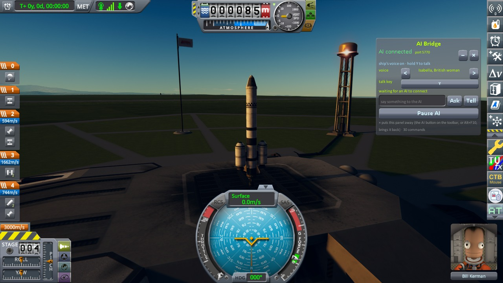

# Voice edition

The same mod with a voice. The ship's computer calls out the flight as it happens: "Lift-off."
"Passing maximum dynamic pressure." "Staging." "Orbit achieved: 99.5 km by 98.5 km." "Burn in 10 seconds."
"Entering the sphere of influence of Duna." "500 metres. 200. 100. 50." "Touchdown on Duna." It warns
("Propellant at 10 percent", "Signal lost", "Impact imminent", "Landing gear is up", a part overheating)
and it says whatever the AI wants to tell you. It speaks inside the game, through the game's own sound and
volume sliders, with the words on screen as well, and it does so whoever is flying: the AI or you.

You can talk back. Hold **Y** in the game, say "put us in a hundred-kilometre orbit", and let go.

Speech is made by [Kokoro](https://github.com/thewh1teagle/kokoro-onnx) and understood by
[Whisper](https://github.com/SYSTRAN/faster-whisper), both running on your computer. No account, no key,
and nothing you say leaves the machine.

On macOS or Linux:

```bash
./setup_voice.sh
```

On Windows, from PowerShell in the mod's folder:

```powershell
powershell -ExecutionPolicy Bypass -File .\setup_voice.ps1
```

That downloads about 0.6 GB (the two models and their Python packages) into `~/.ksp-ai-bridge/voice`
(`%USERPROFILE%\.ksp-ai-bridge\voice` on Windows); delete the folder to be rid of them. It needs a 64-bit
Python 3.10 to 3.13 (or `uv`, which fetches one). Without it the voice edition still works, using the
operating system's own voice and typed commands. (`-ExecutionPolicy Bypass` lets Windows run that one
downloaded script without changing any setting.)

**Tried on macOS and on Windows.** On Windows 11 (2026-10-10) `setup_voice.ps1 -Yes` installed everything
(595 MB, with the Microsoft Store's Python 3.13, and the 74 standard call-outs made ready); the ship said lines
in the game with Windows' own voice (PowerShell's speech synthesiser) and with Kokoro (`ksp_voice.py say`);
and three lines Kokoro spoke into files were written down by Whisper word for word ("eighty" as "80"), in
about 0.7 s a line once loaded, and taken by the game as heard speech (`voice_heard`, then `voice_next`). The
microphone was opened there (`ksp_voice.py mic`: two seconds, only the levels kept): the default input, a GoXLR's
"Broadcast Stream Mix", read a quiet room (peak 36, where speech counts from about 260). Nobody spoke to it, so
listening through it has not been tried. Nothing of the voice edition has run on Linux. On Windows the microphone must be allowed for desktop apps
(Settings, Privacy & security, Microphone). On Linux the operating system's voice is `espeak-ng` and the
microphone needs PortAudio: `sudo apt install espeak-ng libportaudio2` (or your system's packages).

**With Claude.** Say "turn on the ship's voice": from then on the ship narrates by itself, and Claude adds
what only it knows (the plan, an answer, a decision). Say "listen for my voice commands": Claude then waits
for you to speak, does what you said, answers out loud and listens again.

**With a model on your own computer:**

```bash
python3 mcp/ksp_local.py --voice
```

**Just the commentary**, for flying by hand:

```bash
python3 mcp/ksp_voice.py narrate
```

## The voice and the talk key, in the game

When the voice edition is set up, the AI Bridge panel has two more lines. **voice** has arrows to go
through the 28 English voices; if the ship's computer is narrating, it says a line in the voice you stop
at. **talk key** shows the push-to-talk key: click it, then press the key, extra mouse button or
controller button you want (Esc keeps the old one). While you pick, the game itself does not see the key,
so Space does not stage the rocket. When the key is also one of the game's own, the panel says so (B is
the brakes): holding it to talk does both. A choice takes effect at once, without restarting anything.



## Settings

All of them are kept in `~/.ksp-ai-bridge/voice.json`, which the panel writes too:

```bash
python3 mcp/ksp_voice.py set voice=bm_george speed=1.05 effect=radio detail=chatty key=F8
```

`voices` lists the 54 voices (28 English: `a` American, `b` British, then `f` or `m`); `effect` is `ship`
(the default: intercom chirp, a little room), `radio` or `none`; `detail` is `quiet` (milestones and
warnings), `normal` or `chatty`; `key` is the push-to-talk key, a Unity key name (`Y`, `F8`, `Mouse4`,
`RightControl`). A narrator or listener that is already running takes a change up before its next line.
`status` shows what is installed, `mic` checks the microphone (it reads the loudness only). The first
time, macOS asks whether the app the listener runs in (Claude, or your terminal) may use the microphone.

How it fits together: the plugin writes the commentary (it knows the instant a stage fires), watches the
talk key, plays the audio and shows the captions; `mcp/ksp_voice.py` turns text into speech and speech into
text. Standard call-outs are made ahead of time so a height is heard at that height.
