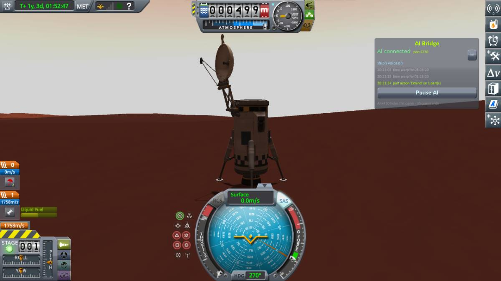
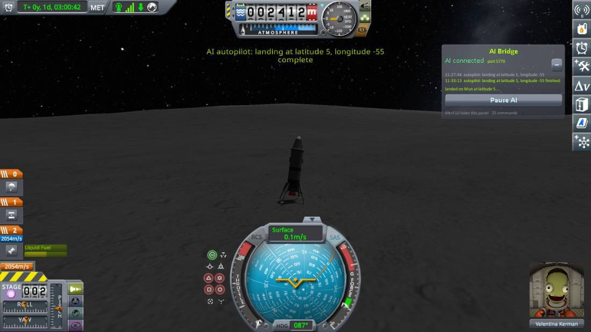
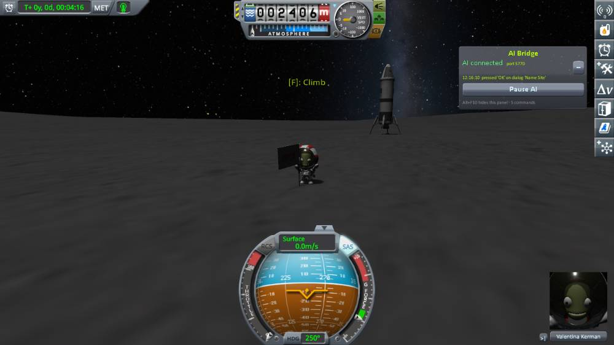

# What has been flown

Everything below was run in a real KSP 1.12.5 sandbox through the plugin's commands, with no human input:

* A two-stage rocket with radial boosters, built from a parts list, flown to a 79.8 x 78.5 km orbit.
* A 54 t three-stage Mun lander: orbit, transfer (862 m/s, staging mid-burn), capture into a
  23 km Mun orbit, powered landing at 1.8 m/s on its legs, ascent, return burn to a 32 km Kerbin
  periapsis, reentry, parachute, splashdown and recovery.
* **Landing at chosen coordinates:** from a 14 km Mun orbit to latitude 5.0000, longitude -55.0000,
  including a 9.7 degree plane change in the de-orbit burn. It touched down at 5.0003, -55.0051: 18 m off,
  for 785 m/s. Flown again three times after later changes to the landing code, from the same save: 17 to
  23 m off each time. The first two of those spent far more fuel (878 and 1,118 m/s) because the de-orbit
  planner was choosing its burn by miss distance alone; it now weighs fuel as well, and the third flight
  landed 18 m off for 802 m/s.
* **Atmospheric landing:** a capsule in a 78 km Kerbin orbit flew its own de-orbit burn, dropped its
  service module, held retrograde through re-entry, opened the parachute at 16 km and landed at 6.1 m/s.
* **Aimed at the launch pad from orbit:** the same capsule, with the de-orbit burn timed from a prediction
  of its drag, came down 252 m from the pad. (The drag model was checked against the game during a
  descent: 26.27 against 26.29 m/s² at Mach 3.6.)
* **On Windows** (2026-10-10, Windows 11, KSP 1.12.5 on Direct3D 11, the workspace's other mods installed): the
  stock Kerbal X flown from the pad to an 80 km orbit by `ascent` (79.8 by 78.5 km, 0.09 degrees, in about three
  minutes with warp; flown twice, the same to 15 m), and `land` with `place: ksc, stage: true` brought its capsule
  down from that orbit under its parachute, 414 m from the space centre, at 9.3 m/s (peak 13 g). The first try
  without `stage` crashed: see [the limits](Limits.md). The same that evening, 557 m off at 9 m/s (peak 14.2 g),
  and then on the release build three rounds in a row (launch, `ascent`, `land` with `place: ksc, stage: true`,
  `recover`): 588, 691 and 643 m off, at 8.6, 1.7 and 2 m/s (peaks 14.4, 14.2 and 13.6 g), each orbit 79.8 by 78.5
  km in 185 s.
* **No parachutes:** a legged lander with only an engine landed after a 2.7 km hop (3.3 m/s) and again
  from an 80 km orbit through re-entry (4.2 m/s).
* **To Duna and down onto a chosen spot.** A 51 t probe lander ("Duna Explorer", built from a parts list)
  flew the whole trip on flight plans: launch to a 99.5 x 98.5 km parking orbit, a 226-day wait for the
  window, the 1,061.5 m/s departure burn (0.02 m/s off), a 2.6 m/s correction, 48 days of cruise, a 13 m/s
  trim inside Duna's sphere of influence, and a 1,006 m/s capture burn that ran the transfer stage dry and
  carried on with the lander's engine, into a 66 x 54 km polar orbit. From there it was told to land at
  latitude -2, longitude 36.25, a flat patch picked with `ksp_terrain`. The air on Duna is too thin to
  stop a lander like this (it would still be doing 410 m/s near the ground), so the engine braked it,
  tail-first against the airflow, to a stop 2 km above the spot; the parachutes opened for the drop and it
  touched down at 2 m/s, **43 m from the coordinates**, for 734 m/s. Getting there took five descents from
  the same save: 19 km short with braking that ignored the spot, a hover that swung back and forth over
  it, one crash, 170 m, then 43 m.
* **Thin air, unaimed:** an earlier lander of the same kind, put into Duna orbit with the game's debug menu
  function, came down four times running at 2.1 m/s for about 550 m/s.
* **Docking:** two halves of a test craft undocked in orbit; the chaser was pushed away until it was 396 m
  off, drifting at 6.8 m/s and facing elsewhere. It flew back, lined up in front of the port and docked
  149 seconds later on 3.8 units of monopropellant, closing at under 0.1 m/s on the port's centre line.
  With the target left turning at 2.3 degrees a second it followed the port round and docked 1 cm off the
  line; at 17 degrees a second it declined and said why.
* **Aircraft:** a delta-wing jet built from a parts list took off, flew a circuit and landed back on the
  KSC runway on the centreline; the stock Aeris 3A flew from the KSC to the island airfield and landed on
  its 1.15 km strip, stopping 97 m after touchdown and 0.1 m from the centreline. Told to cruise at
  1,000 m toward a 4,800 m mountain range, the jet climbed to 5,083 m by itself and crossed it.
* **Rover:** the stock Bug-E Buggy drove 400 m along the runway to within a few metres of its target, then
  to a point on the far side of the Administration building, going round the building and an abandoned
  rover on the way and stopping 2 m from the spot.
* **EVA:** on the Mun, a kerbal left the lander, dropped to the surface, walked 25 m, planted and named a
  flag, took an EVA report, and flew back up to the hatch by jetpack. In Kerbin orbit a kerbal crossed
  160 m to another ship by jetpack and came back aboard. On the launch pad, where the jetpack cannot lift
  a kerbal, one climbed down, walked away, came back, took the ladder and climbed in.
* **Builder:** an asparagus rocket whose fuel lines demonstrably drained the side tanks first, struts,
  mirrored wings with elevons, upright landing gear; fairing shells fitted over a payload, and two kinds of
  interstage, each launched and staged so that the shell was thrown off as the stage under it separated
  and the upper engine lit.
* **Structure:** a 36 t tank on a neck of six small tanks over a Mainsail, estimated at 1.4 (folds), bent
  3 to 3.7 degrees and went over after a short steering input; with four struts (estimated 0.07) or one
  autostrut (0.21) the same craft, given the same input, climbed straight to over 2 km, the neck's joints
  carrying nothing.
* **Unattended flight plans:** launch to orbit, an orbit change and a save as one six-step plan (397 s with
  no call open); an aircraft's take-off, cross-country flight and landing as another; the legs of the Duna
  flight above.
* A rendezvous ending 162 m from the target at 0.0 m/s; plane changes, career and science saves,
  quicksave and quickload, vessel switching, part menus in flight and in the editor.
* **The ship's voice** (voice edition): the Duna flight was narrated from the pad to the surface. What the
  game played was recorded from its own voice channel and given to the speech recogniser, which wrote down
  "Flight computer online, vessel Duna Explorer ... beginning gravity turn, supersonic, passing maximum
  dynamic pressure, staging, staging. We have left the atmosphere, coasting to apoapsis"; the same check
  passed for the ship, radio and plain effects. On the first ascent three lines made no sound although
  the game reported them spoken; the cause was not found, a line that fails to start is now tried again,
  and the 80-odd lines of the later legs all sounded.
* **Spoken orders** (voice edition): a recorded question ("What planet are we on, and how much liquid fuel
  is left?") went through Whisper to a local model, which read the telemetry, and the game said
  "Acknowledged. We are on Duna. There is 88 units of liquid fuel left." The Claude route was run through
  the real tool protocol: `ksp_voice listen` returned "Put us in a 100-kilometre orbit around Kerbin, then
  quicksave." For both, a recording stood in for the microphone and a test command for the Y key, since
  the session that built this cannot speak; the microphone itself was only checked for a signal.

